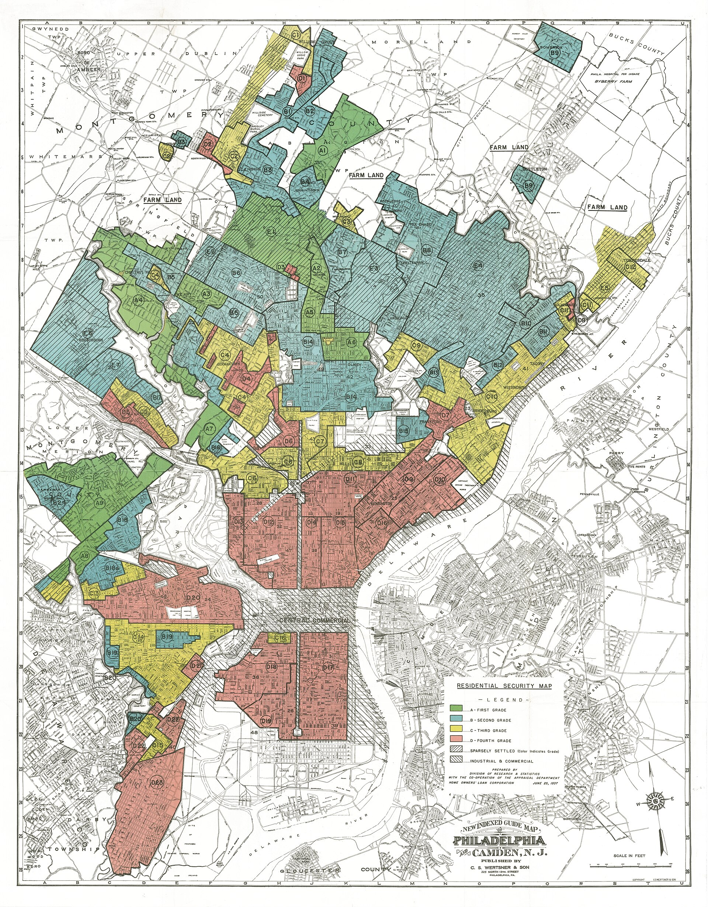
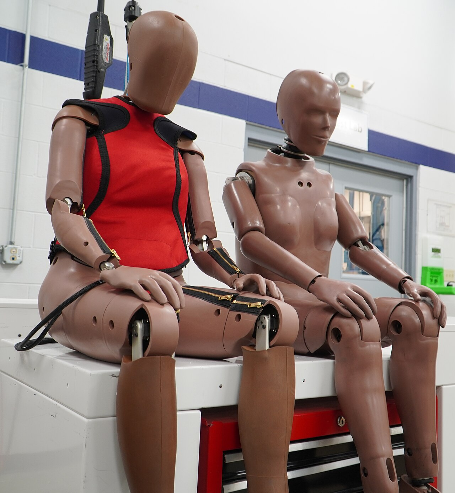
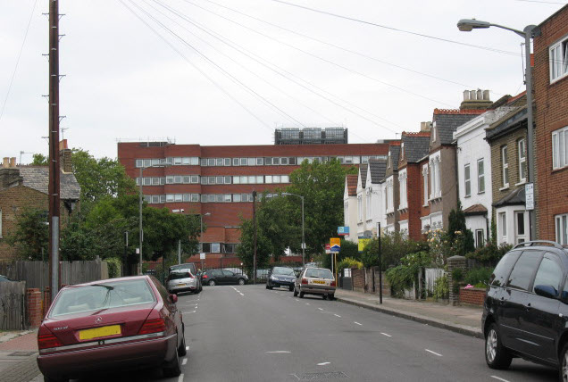
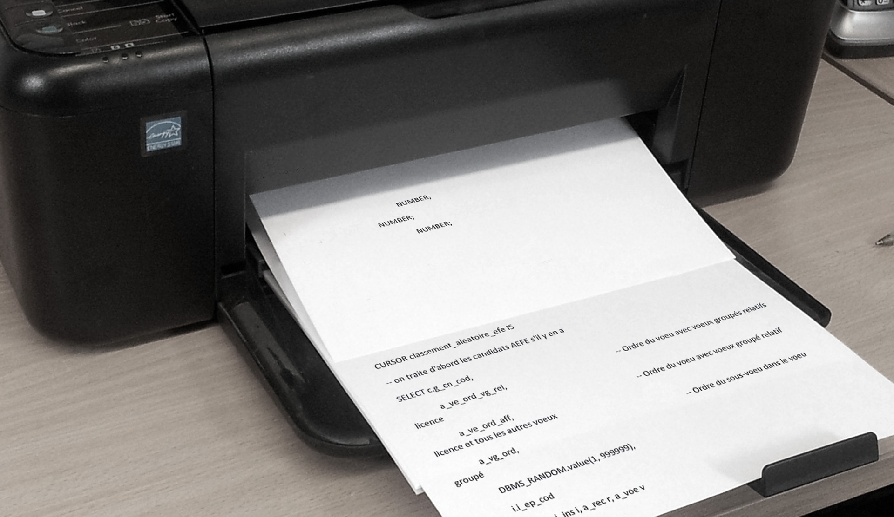
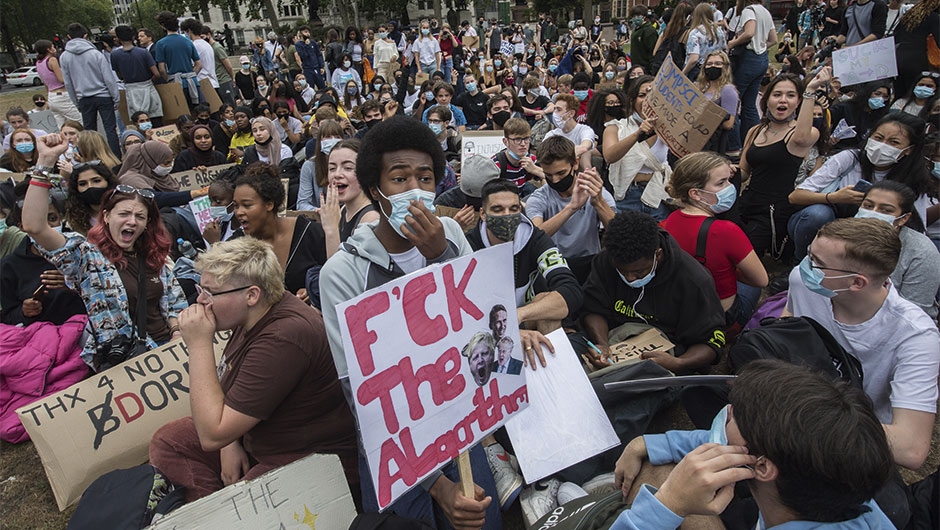
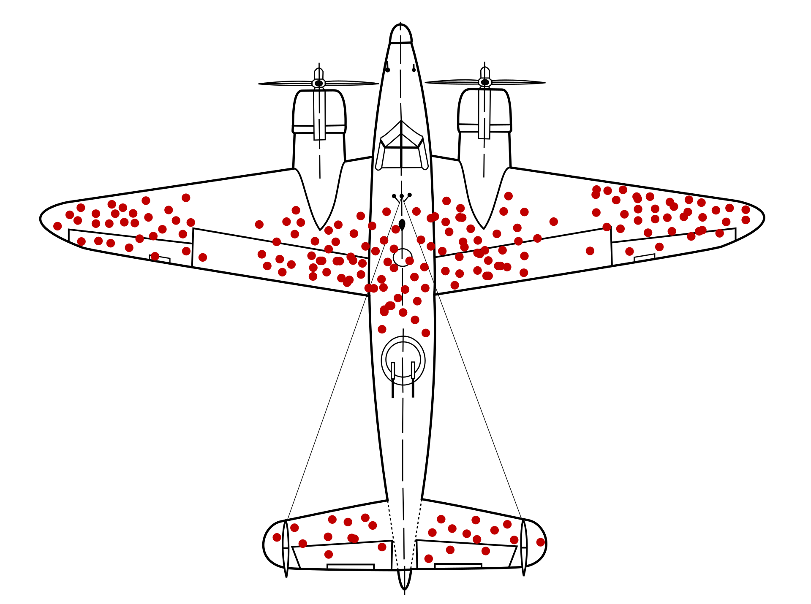
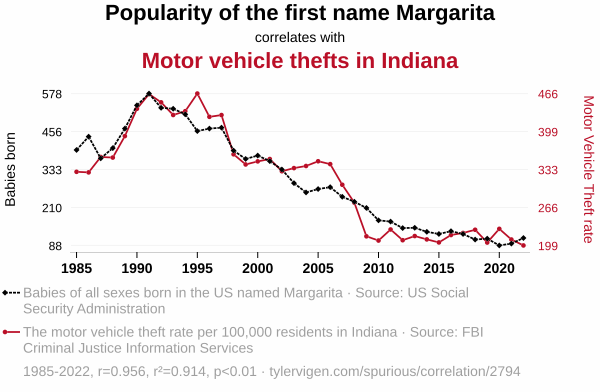
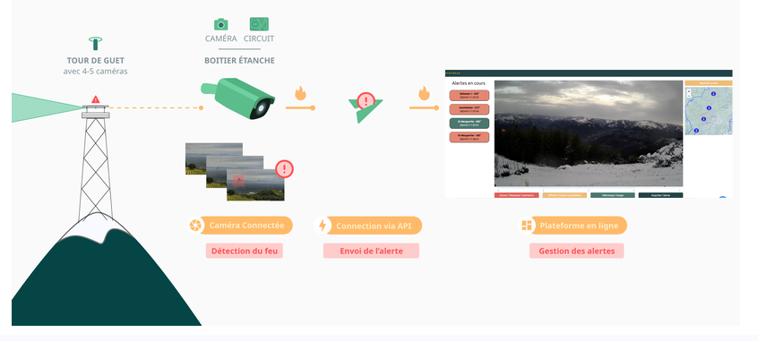

# Neutralité et algorithmes

Élise & Quentin

---

# Pour commencer

Vous êtes data scientist à la CNAF : 
- 13.8 millions de foyers allocataires
- ~700 contrôleurs

**Votre mission** : déterminer quels dossiers contrôler pour récupérer le plus d'argent versé à tort

---

## Choisissez 5 variables

| | |
|---|---|
| Niveau de revenus | Code postal |
| Variabilité des revenus | Nationalité |
| Situation familiale | Âge |
| Type d'allocation | Ancienneté du dossier |
| Changements de situation déclarés | Situation professionnelle |

---

## Ce modèle existe vraiment

<!-- .slide: class="img-right" -->

Donne à chaque foyer un score recalculé chaque mois.

10 variables retenues parmi 1000. Celles qui font monter le score (version 2010-2018) :

- faibles revenus, chômage, RSA
- handicap (AAH), surtout avec un emploi
- parent isolé
- quartier défavorisé

<small>Sources : La Quadrature du Net (2023), Le Monde (2023), Amnesty (2024)</small>

---

## Fraude ou erreur ?

<!-- .slide: class="img-right" -->

Le modèle prédit les **trop-perçus**, pas la fraude

On se trompe là où les règles sont compliquées (les erreurs vont dans les deux sens, et l'exemple AAH va dans ce sens) <!-- .element: class="fragment" -->

Le score ne voit pas l'intention : il mesure surtout l'exposition à des règles complexes <!-- .element: class="fragment" -->

Le code postal peut ici être vu comme un proxy vers des variables plus problématiques <!-- .element: class="fragment" -->

---

## Qu'est-ce qui pose problème et pourquoi ?

Des causes potentiellement multiples, mais en général elles s'appuient sur une reproduction du passé et une confusion entre corrélation et causalité.

Neuf exemples, de 1935 à aujourd'hui

---

## 1935 : redlining

<!-- .slide: class="img-right" -->

La prophétie auto-réalisatrice <!-- .element: class="tag" -->

239 villes américaines notées de A à D <!-- .element: class="fragment" -->

Pas de prêt -> pas d'investissement -> le quartier se dégrade -> la carte "avait raison" <!-- .element: class="fragment" -->

On retrouve la notion de proxy <!-- .element: class="fragment" -->

Les effets subsistent encore à ce jour (livraisons, santé, ...) <!-- .element: class="fragment" -->

<small>Source : Mapping Inequality, Université de Richmond</small>

---

## Années 1970 : crash-tests

<!-- .slide: class="img-right" -->

Le dataset d'entrainement <!-- .element: class="tag" -->

Mannequin de référence = l'homme "moyen" <!-- .element: class="fragment" -->

Conductrices : risque de blessure grave +47% <!-- .element: class="fragment" -->

Biais dans l'échantillon statistique, avec lien sur le modèle physique. <!-- .element: class="fragment" -->

Ce type de biais se retrouve encore par exemple dans la pharmacologie moderne (eg somnifère Zolpidem). <!-- .element: class="fragment" -->

<small>Source : Bose et al., American Journal of Public Health, 2011</small>

---

## 1979 : St George's, Londres

<!-- .slide: class="img-right" -->

La reproduction du passé <!-- .element: class="tag" -->

Programme écrit par un enseignant pour imiter jury d'admission : jusqu'à 95 % de corrélation. Peut-on en déduire que c'était satisfaisant ? <!-- .element: class="fragment" -->

En 1982, toute la présélection est faite par ordinateur. <!-- .element: class="fragment" -->

L'algo pénalise les femmes et les noms non européens, comme le jury le faisait, avec jusqu'à 60 candidats écartés par an <!-- .element: class="fragment" -->

Fin de l'algo en 1988, 9 ans après, jugement pour discrimination <!-- .element: class="fragment" -->

> "The prejudice of a computer is no less than that of its designers" <!-- .element: class="fragment" -->

<small>Source : Lowry & Macpherson, BMJ, 1988</small>

---

## 2016 : APB

<!-- .slide: class="img-right" -->

La boîte noire <!-- .element: class="tag" -->

Ancêtre de Parcoursup <!-- .element: class="fragment" -->

En mars 2016 : association de lycéens demande le code source <!-- .element: class="fragment" -->

En octobre, après des mois de bataille judiciaire, le code (partiel !) est envoyé imprimé par la poste, sur papier : cas de "malicious compliance" <!-- .element: class="fragment" -->

Sans code source, pas d'audit, et pas de biais détectable <!-- .element: class="fragment" -->

Mise en demeure de l'État par la CNIL (épinglé pour procédure sans cadre juridique) <!-- .element: class="fragment" -->

<small>Sources : Next, L'Etudiant EducPros, 2016</small>

---

## 2014-2017 : Amazon et les CV

<!-- .slide: class="img-right" -->

Le dataset d'entrainement <!-- .element: class="tag" -->

Outil de tri entraîné sur 10 ans de CV reçus, surtout masculins <!-- .element: class="fragment" -->

Le genre n'est pas une variable... <!-- .element: class="fragment" -->

...mais le mot "women's" (ex : women's chess club) dans un CV fait baisser la note <!-- .element: class="fragment" -->

Il s'agit encore une fois d'un proxy, neutralisé mais comment s'assurer que le modèle n'en utilisera pas d'autres ? <!-- .element: class="fragment" -->

<small>Sources : Reuters, Numerama, 2018</small>

---

## 2020 : A-levels

<!-- .slide: class="img-right" -->

Correlation <> causation <!-- .element: class="tag" -->

Covid : examens annulés et notes ajustées selon l'historique du lycée <!-- .element: class="fragment" -->

Objectif du modèle : éviter l'inflation des notes <!-- .element: class="fragment" -->

39,1 % des notes abaissées, très majoritairement dans les milieux défavorisés <!-- .element: class="fragment" -->

Héritage in-code des notes des prédécesseurs. <!-- .element: class="fragment" -->

Manifestations <!-- .element: class="fragment" --> *Fuck the algorithm* -> retrait en 4 jours

<small>Sources : Ofqual, HEPI, 2020</small>

---

## 2024 : des modèles de langage trient les CV

<!-- .slide: class="img-right" -->

Le dataset d'entrainement <!-- .element: class="tag" -->

Mêmes CV, seul le prénom change <!-- .element: class="fragment" -->

Prénoms associés aux personnes blanches préférés dans 85 % des cas <!-- .element: class="fragment" -->

Prénoms féminins préférés dans 11 % des cas <!-- .element: class="fragment" -->

Hommes noirs : désavantagés dans jusqu'à 100 % des cas <!-- .element: class="fragment" -->

Pas un "algo entraîné à recruter" mais un apprentissage non supervisé entraîné sur les données du web... <!-- .element: class="fragment" -->

<small>Source : Wilson & Caliskan, Université de Washington, 2024</small>

---

## 2024-2026 : l'IA générative, aux dernières nouvelles tout va bien

<!-- .slide: class="img-right" -->

Pour un texte en anglais standard vs afro-américain, le modèle propose des emplois moins prestigieux et plus de condamnations à mort (Nature, 2024) <!-- .element: class="fragment" -->

À profil identique, les chatbots conseillent aux femmes de demander moins (THWS, 2025) <!-- .element: class="fragment" -->

Un outil utilisé par plus de 50% des villes anglaises résume les dossiers d'aide sociale et minimise le plus souvent les besoins des femmes (LSE, 2025) <!-- .element: class="fragment" -->

La semaine dernière : à IA identique, l'avatar féminin est rémunéré 10 % de moins par les utilisateurs (Limerick, 2026) <!-- .element: class="fragment" -->

<small>Sources : Hofmann et al., Nature ; HR Dive ; THWS ; LSE ; Université de Limerick via Euronews</small>

---

## En résumé

Une multiplicité des mécanismes 

| Dans les données | Dans le modèle | Dans l'usage |
|---|---|---|
| La reproduction du passé | Correlation <> causation | La prophétie auto-réalisatrice |
| Le dataset d'entrainement | La loi de Goodhart | La boîte noire |
| Les survivants | | |

---

## Et la CAF ?

Elle en cumule beaucoup !

- reproduction du passé : apprise sur les contrôles passés <!-- .element: class="fragment" -->
- correlation <> causation : précarité et erreurs <!-- .element: class="fragment" -->
- loi de Goodhart : l'indicateur, c'est l'argent récupéré <!-- .element: class="fragment" -->
- prophétie auto-réalisatrice : plus de contrôles, plus d'indus trouvés <!-- .element: class="fragment" -->
- boîte noire : code inaccessible jusqu'en 2023 <!-- .element: class="fragment" -->

---

## Comment cela se retrouve dans nos expériences

---

### Élise

- Data scientist/analyst dans une PME pendant 2 ans sur des projets d'**optimisation de collectes de déchets**
- Projet **My City'Challenge** : optimisation du positionnement de bennes de tri sélectif dans une ville
- Travail sur les **différentes phases du projet** : récolte des données, préparation, stratégie d'analyse, clustering, modèle prédictif, carte de chaleur pour identifier des lieux où déplacer des bennes, expérimentation, rapport
- **Questionnements par rapport aux limites du modèle**
- On juge la qualité d'un modèle sur le critère qu'on a décidé d'optimiser, mais est-ce toujours le bon critère ?
  
---

### Quentin

- Entreprise majeure du BTP : optimisation de cycles de grue et de tombereaux. Si on optimise ça doit être mieux ? <!-- .element: class="fragment" -->
- Startup de traitement de données géospatiales : from massification de la rénovation énergétique to pricing assurance <!-- .element: class="fragment" -->
- Coopérative data pour projets public : conduit par l'impact <!-- .element: class="fragment" -->

---

## Atelier : Quelle gouvernance pour les algorithmes ?

On vous propose de dé/reconstruire des algorithmes, et de réfléchir à qui a une voix dans la manière dont ces systèmes sont décidés, conçus et évalués. 

---

## Les cas d’étude

---

## Temps 1 : cartographie d’acteurs

Qui est en prise avec l’algorithme ? 
Comment l’influence-t-il ? Comment est-il impacté ?

---

## Fiche acteur

**Type d’acteur** - Une explication associée

**Influence de l’acteur** - On entend par influence la capacité de l’acteur à orienter 
la conception de l’algorithme, que ce soit dans son fonctionnement ou dans son existence même. 

**Impacts sur l’acteur** - On entend par impact tout effet positif ou négatif que l’algorithme peut avoir sur la structure. 

*Par exemple : l’algorithme peut-il avoir une conséquence sur la vie d’un administré ? Sur les conditions de travail des agents publics ? Sur les politiques publiques menées par une administration ?*

---

## Temps 2 : penser de nouvelles modalités de gouvernance

Dans un monde idéal, quelle(s) forme(s) de gouvernance mettre en place pour permettre à plus d’acteurs d’avoir un poids dans la prise de décision ?

---

## Quelques initiatives inspirantes

- **ACLU Massachusetts** : Community control over police surveillance
- **Algorithme d’attribution de greffons de reins**
- **Māori Algorithmic Sovereignty** : souveraineté algorithmique maorie

---

## Fiche gouvernance

**Acteur** - Choisir un acteur sur lequel vous souhaitez vous concentrer

**Influence** - Définissez le type d’influence que l’acteur devrait avoir

**Modalité de gouvernance** - Quelle(s) solution(s) envisager pour permettre à l’acteur de participer à la prise de décision sur le système algorithmique et d’accroître son influence dessus ?

*Vous êtes libres dans les solutions que vous envisagez : cela peut se situer au niveau des interfaces existants pour interagir avec l’algorithme, peut être une proposition de création d’un collectif d’audit citoyen, la création d’une loi pour interdire ou rendre obligatoire certaines pratiques…*

---

## Débat mouvant

D'accord : à gauche / pas d'accord : à droite

Je suis personnellement responsable si le travail qu'on me demande a un fort risque de biais discriminatoires. <!-- .element: class="fragment" -->

Les algorithmes utilisés dans des domaines critiques (santé, justice, finance) doivent être open source pour permettre leur audit. <!-- .element: class="fragment" -->

---

# Et pour finir quelques réflexes à adopter, par les exemples

---

## 1943 : les avions qui reviennent

Le biais du survivant <!-- .element: class="tag" -->

> Les données manquantes ne manquent jamais au hasard

<small>Abraham Wald, Statistical Research Group, 1943</small>

---

## 1902 : les rats de Hanoï

La loi de Goodhart <!-- .element: class="tag" -->

> Quand une mesure devient une cible, elle cesse d'être une bonne mesure - Marilyn Strathern, 1997

---

## 201x : Internet

Spurious correlations <!-- .element: class="tag" -->

> Si on torture les données assez longtemps, elles finissent par avouer - Ronald Coase, années 1960

<small>Graphique : Tyler Vigen, Spurious Correlations</small>

---

## 1973 : les admissions de Berkeley

Le paradoxe de Simpson <!-- .element: class="tag" -->

Taux d'admission en master, automne 1973

| | Hommes | Femmes |
|---|---|---|
| Toutes filières | 44 % | 35 % |
| Filière A | 62 % (825 candidats) | 82 % (108 candidates) |
| Filière B | 63 % (560) | 68 % (25) |
| Filière F | 6 % (373) | 7 % (341) |

> Un chiffre global peut dire l'inverse de chacune de ses parties

<small>Bickel, Hammel & O'Connell, Science, 1975</small>

---

## Et par rapport à l'algo de la CNAF

Qu'est-ce que vous changeriez ?

Pas de réponse générale hélas mais quelques pistes : <!-- .element: class="fragment" -->
- Requestionner le besoin <!-- .element: class="fragment" -->
- Traiter la cause <!-- .element: class="fragment" -->
- Encadrer le modèle de ciblage (si le besoin reste avéré) <!-- .element: class="fragment" -->

---

## Quelques questions à vous poser

1. Sur quelles données du passé mon algo est-il entraîné, et qui en est absent ? <!-- .element: class="fragment" -->
2. Quel critère j'optimise, et qui l'a choisi, à quoi servira-t-il ? <!-- .element: class="fragment" -->
3. Ce résultat n'est-il pas trop beau pour être vrai ? <!-- .element: class="fragment" -->
4. Le chiffre global tient-il quand je le découpe ? <!-- .element: class="fragment" -->
5. D'où vient la demande, et les parties prenantes peuvent-elles contester ou auditer ? <!-- .element: class="fragment" -->
6. Est-ce que j'ai un regard critique, statistique et citoyen, produit, et pas juste "belle techno" ? <!-- .element: class="fragment" -->

---

## Où et comment agir

Dans des assos : 
- Data for Good
- La Quadrature du Net
- The Shift Project

Mais surtout en faisant bien votre métier au quotidien <!-- .element: class="fragment" -->

---

## Petit focus Data for Good : quelques exemples de projets

---

### Biolit

<!-- .slide: class="img-right" -->

Améliorer l’analyse des informations récoltées par les citoyen·nes pour mieux surveiller la biodiversité du littoral français en :
- Optimisant l’identification et la validation des observations
- Améliorant le partage des données avec les partenaires
- Valorisant les données via un tableau de bord

2 modèles ML qui aident à traiter des photos d'espèces du littoral :
- Le 1er pour détecter l'espèce dans la photo pour cropper autour d'elle
- Avant d'envoyer au 2e modèle qui se charge d'analyser l'image croppée pour identifier de quelle espèce il s'agit

---

## Petit focus Data for Good : quelques exemples de projets

<!-- .slide: class="img-right" -->

**Pyronear**

Solution open source de détection précoce des feux de forêt utilisant des stations de surveillance automatisées (images vidéo) pour alerter rapidement les pompiers

---

# Merci, des questions ?

---

# En plus 

---

## Retour en 1935 : la cartographie radicale

<!-- .slide: class="img-right" -->

Les mêmes outils peuvent aussi rendre visible

1968-1971 : à Detroit, le géographe William Bunge fait cartographier la ville par ses habitants <!-- .element: class="fragment" -->

2016 : les cartes de redlining numérisées et ouvertes à tous (Mapping Inequality) <!-- .element: class="fragment" -->

> Qui choisit ce qu'on mesure choisit ce qu'on voit <!-- .element: class="fragment" -->

<small>Sources : W. Bunge, Fitzgerald, 1971 ; Université de Richmond</small>
